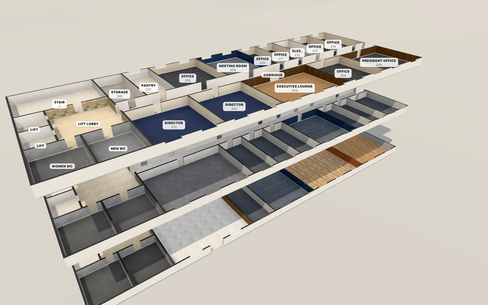
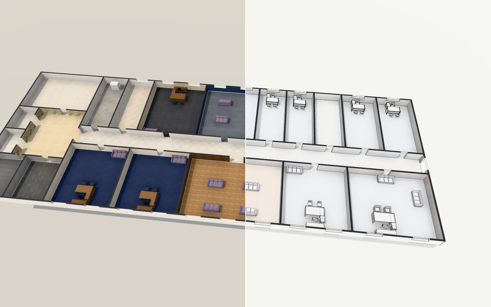
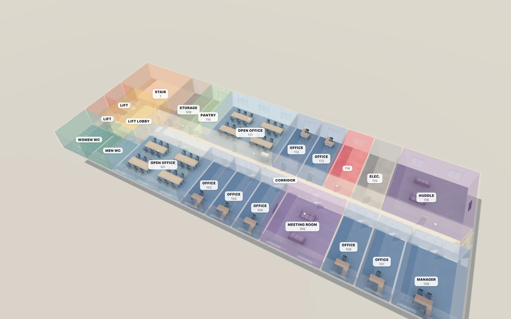
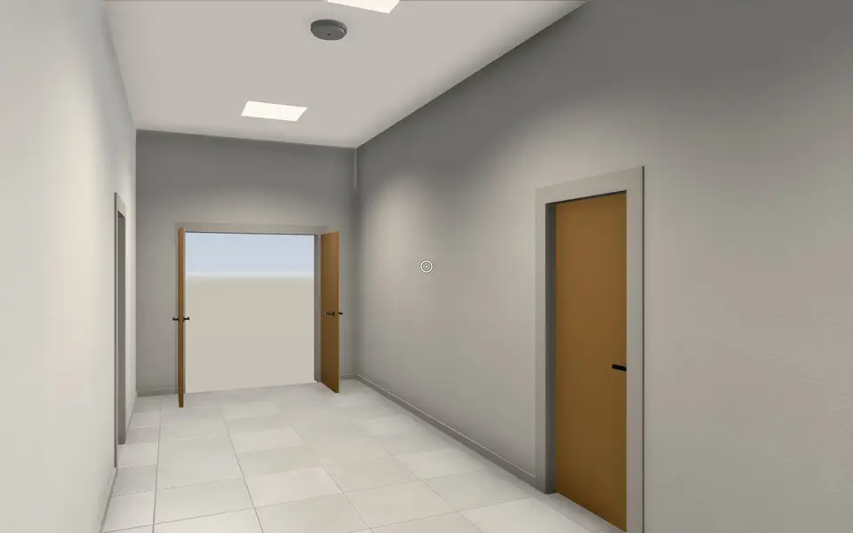
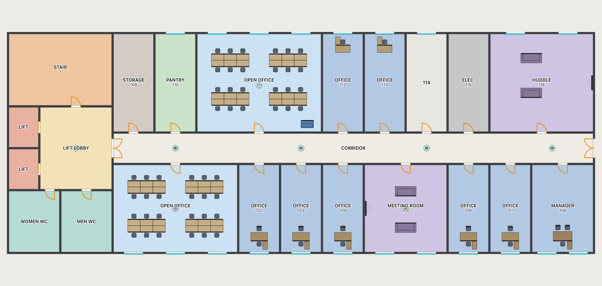
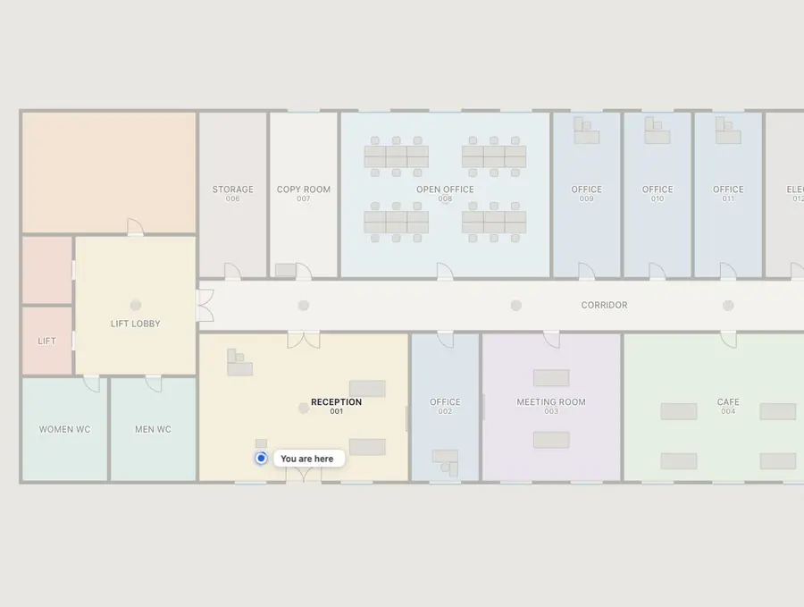
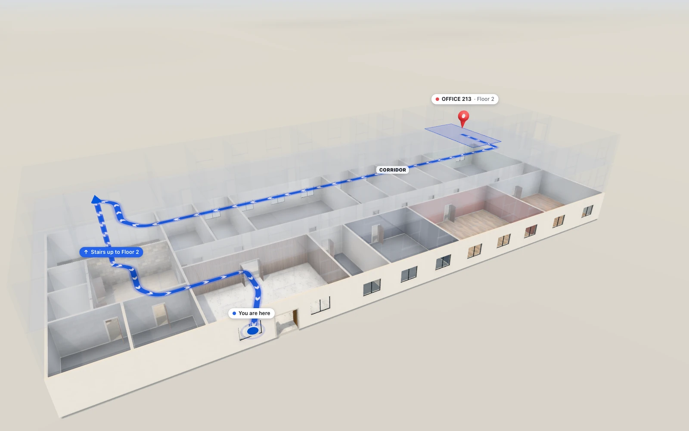

<h1 align="center">StoreyPath Viewer</h1>

<p align="center">
  <b>The StoreyPath package format, and everything that reads it.</b><br>
  A 3D world you can orbit and walk through, a 2D plan that needs no GPU, the drawing
  itself as it was drawn, the way from a kiosk to an office, and a Go reader: for any web
  app or system that wants indoor maps with IDs that never change.
</p>

<p align="center">
  
</p>

A `.storeypath` package is one building as plain JSON, GeoJSON and CSV in a ZIP: its
levels (floors, mezzanines and the roof), rooms and zones, doors and windows, furniture
and equipment with their asset tags (a card reader with the door it serves, a camera
with what it sees), floor and wall finishes, the walking network between them, and,
when its export asked for them, each floor's drawing as drawn. Every object has an ID
that never changes, and a package may be sealed with a password. Packages are made with
[StoreyPath Studio](https://github.com/StoreyPath/storeypath-studio), which pins a version
of this repository, so a package and the code that reads it always agree.

| Folder | What it is |
|---|---|
| [spec/](spec) | **The format**: [FORMAT.md](spec/FORMAT.md) (format 0.11.0), [DRAWING-VIEW.md](spec/DRAWING-VIEW.md) (a drawing as drawn), JSON Schemas, the list of finishes, and conformance packages with the ways every reader must find the same |
| [viewer/](viewer) | **The viewers**, to embed in a web app: the 3D world, a map view, the 2D plan ([viewer/svg](viewer/svg)) that needs no WebGL, the drawings themselves ([viewer/src/drawing](viewer/src/drawing)), and finding the way ([viewer/src/navigation.js](viewer/src/navigation.js)) |
| [go/](go) | **A Go module** that reads and validates packages and finds the way in a building, standard library only |

## The 3D world



`StoreyPathWorld` builds a building from its package alone: walls at the thickness they
were drawn, doors with architraves and handles, windows with glass, skirting, stairs with their steps, furniture
and equipment, each piece an item of its own (format 0.10: a desk, a table, each chair;
each type drawn as its 3D model when it has one, else as its catalogue's shape says, else
as its code's first part does),
floors and walls in their finishes,
under a sun with soft shadows. Two looks, one call apart: **Real** or **Model**, an
architect's white model with its edges drawn; and a quality that suits the machine (Auto
takes Low on built-in, virtual or software graphics). Orbit it as a dollhouse, one floor
or all, cut away, lifted apart, or in x-ray:



Every level stands where it is (format 0.11): a mezzanine at its own height over part of
its floor, on a slab of its own; the roof's deck open to the sky behind its parapets, the
rooms standing on it under their ceilings, nothing built above it. A room open to the
floor below (an atrium, a void) is a hole in its floor's slab, the floor below seen
through it. The world knows which way north is: `viewBearing` and the `viewturn` event
turn a compass, `turnTo(bearing)` turns the view, and `topView()` looks straight down,
the plan's up at the top.

```js
import { StoreyPathWorld } from "./storeypath-viewer/src/world/world.js";

const world = new StoreyPathWorld("#world", { style: "real" });
await world.open("/files/main-building.storeypath");
world.setFloor("CAMP05-CAMPUS-MAIN-F02");
world.setFloors(["CAMP05-CAMPUS-MAIN-F00", "CAMP05-CAMPUS-MAIN-F02"]);  // or some floors together, the others hidden
world.setCutaway(true);
world.select("CAMP05-CAMPUS-MAIN-F02-0127");   // fly to the president's office
```

### Walk through it, doors and all

<p align="center">
  
</p>

`world.setMode("walk")` starts at the front door: mouse to look, W A S D to move, and
walls, windows and shut doors in the way. A door opens as you walk into it, or with E or a
click at the cross (`setDoors("manual")`: only those); a page opens and shuts doors itself
with `setDoorOpen(id, open)` and hears them with the `dooraim` and `doorchange` events. At
stairs and lifts, `changeFloor(+1)` takes you up.

## The 2D plan, for any machine



`FloorPlanEngine` ([viewer/svg](viewer/svg)) draws one floor as a plain SVG plan: rooms by
type, doors with their swings, windows, items, what a camera covers out to its range
(the one chosen, or every camera's with `coverage`), a search, the way drawn on it. Its
package reader lists a building's levels in their order (a mezzanine after the floor it
stands in, the roof at the top, its deck drawn as a roof). No WebGL and no dependencies,
for machines with no GPU (VDI desktops, kiosks). Strict TypeScript, with its own build
and tests.

## The drawing under the plan

A package can carry each floor's drawing as drawn, when its export was asked to (format
0.11): every line, hatch and text of the floor's part of its drawing, in the building's
own metres. `DrawingView` draws it with WebGL, on its own (CAD or Print, its layers shown
and hidden, its texts sharp at any zoom, the pointer in metres) or under the 2D plan,
following it as it moves, and outlines and names parts of it (`marks`, each one to
click if you like); a system that works on the drawing itself reads its lines and texts
(`readDrawingView`, or the Go module's `Drawing`). StoreyPath Studio's drawing viewer is
the same view: it outlines the plans it found on a sheet, and the parts read as floors.

## Finding the way

<p align="center">
  
</p>

Every package carries its building's walking network (`navigation.json`): its doors and
openings, a point in each room, the lifts and stairs on each floor, its entrances and
kiosks. `route(pkg, from, to, { accessible })` finds the quickest way between any two of
them, or the one without stairs, with its line on each floor and steps ready to show. Both
viewers draw it (`showRoute`) as the best indoor maps do. On the plan, in its calm
`wayfinding` look, light or dark: a line that draws itself in and flows the way it goes,
*You are here* at its start, a round badge where it changes floor (*Up to Floor 2*: a click
shows that floor), a pin and a card on the room it ends in; `playRoute()` walks a dot along
it, floor by floor. In 3D: a glowing ribbon over each floor, a column through the stairs or
the lift, the same marks; the floors it walks on alone (a lift from the ground floor to
the third: those two, the column spanning the floors it rides past; `floors: "all"` keeps
them, faded; floors chosen with `setFloors` show instead); `flyRoute()` takes the camera
along it. Both step through it
(`showStep`). The Go module finds the same way, and
[spec/conformance/routes.json](spec/conformance) holds ways every reader must agree on.



```js
import { route } from "./storeypath-viewer/src/navigation.js";
const way = route(pkg, "6VY9-YE7X-YGR", "CAMP05-CAMPUS-MAIN-F02-0134"); // the reception's kiosk to OFFICE 213
plan.showRoute(way, { style: "wayfinding", fit: true, startLabel: "You are here",
  floorPlan: (id) => floorFromPackage(pkg, id) });   // the plan shows each floor of it itself
await plan.playRoute();                               // a dot walks it, floor by floor
world.showRoute(way, { fit: true, startLabel: "You are here" });
await world.flyRoute();                               // the camera along it, up the stairs
```

## The Go reader

```go
import storeypath "github.com/storeypath/storeypath-viewer/go"

pkg, err := storeypath.Open("main-building.storeypath")
for _, p := range pkg.Validate() { … }                  // problems, each with a stable code
for _, u := range pkg.UnitsOn(floorID) { … }            // the rooms and zones people are placed in
way, err := pkg.Route(kioskItemID, officeID, storeypath.RouteOptions{Accessible: true})
```

Buildings, floors with their levels (floor, mezzanine or roof), spaces, zones and
openings with their IDs, items and their catalogue (a card reader's door, a camera's
view), capacities and grades, finishes, lifts' and stairs' stacks, the way, each floor's
drawing when the package carries it, and packages sealed with a password: standard
library only. [go/README.md](go/README.md).

## Use it

The viewers are plain ES modules: serve them, or install `@storeypath/viewer-world` (the 3D
world as one module, three.js inside: [viewer/world](viewer/world)) and
`@storeypath/viewer-svg` (the 2D plan). Nothing is downloaded at run time: they work
offline. Every option, method and event: [viewer/README.md](viewer/README.md).

```sh
cd viewer/svg && npm ci && npm test      # the 2D plan (BROWSER=0 node test/run.mjs: its tests in Node alone)
cd viewer/world && npm ci && npm test    # the 3D world (headless Chrome; BROWSER=0 likewise)
cd go && go test ./...                   # the Go reader
node spec/finishes.mjs --check           # the finishes' copies agree with spec/finishes.json
```

The pictures here are of StoreyPath Studio's demo campus (all of it made up), taken by
Studio's `docs/media/capture.mjs viewer`.

## Coming

A standalone viewer app (2D, 3D, walking and navigation in one view, read-only),
installable on phones and tablets and usable as a kiosk, built from these viewers.

## Licence

Apache 2.0 ([LICENSE](LICENSE)). The vendored libraries keep their own licences
([viewer/vendor](viewer/vendor)).
